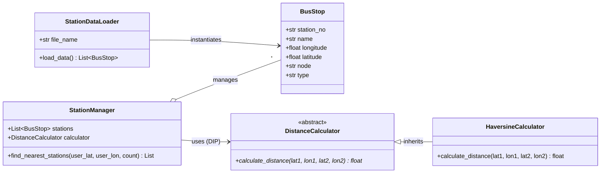
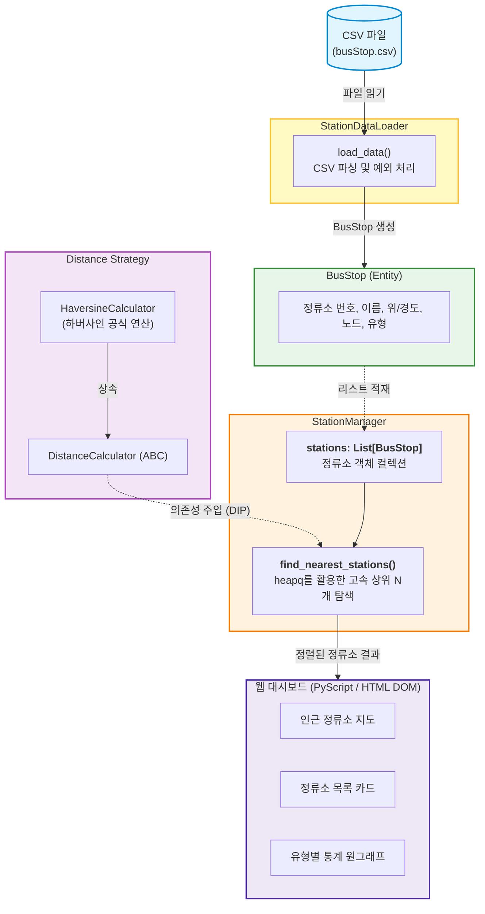

# OOP-kwangwoon
광운대학교 객체지향프로그래밍 팀 프로젝트

# BusFinder

> **서울시 버스 정류소 위치 기반 맞춤형 탐색 대시보드**  
> 사용자의 현재 위치를 기반으로 인접한 버스 정류소를 빠르게 탐색하고, 인터랙티브 지도 및 유형별 분포 통계를 제공하는 객체지향 프로그래밍(OOP) 기반 웹 대시보드입니다.

---

## 목차
1. [프로젝트 개요](#1-프로젝트-개요)
2. [실행 및 배포 방법](#2-실행-및-배포-방법-github-pages)
3. [사용 데이터](#3-사용-데이터)
4. [클래스 설계 및 객체 간 상호작용 (SOLID 원칙 적용)](#4-클래스-설계-및-객체-간-상호작용-solid-원칙-적용)
5. [대시보드 기능 설명](#5-대시보드-기능-설명)

---

## 1. 프로젝트 개요

**BusFinder**는 서울시 버스 정류소 위치 공공데이터를 기반으로 사용자 위치에서 가장 가까운 버스 정류소 정보를 계산하여 직관적으로 시각화하는 웹 애플리케이션입니다.

- **객체지향 설계(OOP) 및 SOLID 원칙 준수**: 개별 정류소 도메인 데이터를 캡슐화하는 `BusStop`, CSV 로딩을 전담하는 `StationDataLoader`, 거리 계산 책임을 분리한 `DistanceCalculator` 및 `HaversineCalculator`, 그리고 정류소 컬렉션 관리 및 탐색 로직을 총괄하는 `StationManager`로 명확히 역할을 분리했습니다.
- **서버리스 웹 런타임 (PyScript)**: 별도의 백엔드 서버 없이 브라우저 환경에서 WebAssembly 기반 PyScript를 실행하여 파이썬 객체지향 연산 로직과 HTML DOM을 직접 바인딩합니다.
- **접근성 극대화**: 정적 웹 호스팅 서비스인 **GitHub Pages**를 통해 링크 접속만으로 즉시 구동됩니다.

---

## 2. 실행 및 배포 방법 (GitHub Pages)

본 프로젝트는 PyScript 런타임을 통해 브라우저 내부에서 파이썬 코드가 실행되므로, 로컬 서버 설치나 종속성 빌드 없이 **GitHub Pages 웹 링크 접속**만으로 실행됩니다.

### 온라인 접속 방법
1. 배포된 **GitHub Pages 배포 링크**에 웹 브라우저로 접속합니다.
  - `https://taeyoung0.github.io/OOP-kwangwoon/`
2. 웹 브라우저의 **위치 정보 접근 권한(GPS)** 허용 알림 창이 나타나면 **'허용'**을 선택합니다.
   *(권한이 차단된 경우, 기본 위치 또는 화면 내 위치 검색 기능을 통해 기준점을 지정할 수 있습니다.)*
3. PyScript 런타임 초기화 및 정류소 데이터 로드가 완료되면 대시보드 화면이 자동으로 표시됩니다.

### GitHub Pages 배포 설정 (저장소 관리자용)
저장소 코드를 GitHub Pages로 서비스하기 위한 단계는 다음과 같습니다:
1. GitHub 저장소 상단 메뉴의 **Settings**로 이동합니다.
2. 좌측 네비게이션 바에서 **Pages** 탭을 선택합니다.
3. **Build and deployment** 항목의 **Source**를 `Deploy from a branch`로 설정합니다.
4. 배포 **Branch**를 `main` (또는 `master`), 디렉터리를 `/(root)`로 지정한 후 **Save** 버튼을 클릭합니다.
5. 배포 빌드가 완료되면 상단에 부여된 URL을 통해 웹 대시보드에 접근할 수 있습니다.

---

## 3. 사용 데이터

서울시 열린데이터광장에서 제공하는 **서울시 버스 정류소 위치 정보** CSV 데이터를 기반으로 구축되었습니다.

| 속성명 | 데이터 타입 | 설명 |
| :--- | :--- | :--- |
| `station_no` (정류소 번호) | `String` | 각 정류소를 식별하는 고유 관리 번호 |
| `name` (정류소명) | `String` | 버스 정류소의 공식 명칭 |
| `latitude` (위도) | `Float` | 정류소의 WGS84 위도 좌표 ($\phi$) |
| `longitude` (경도) | `Float` | 정류소의 WGS84 경도 좌표 ($\lambda$) |
| `node` (노드 ID) | `String` | 교통 네트워크 연계용 정류소 노드 식별자 |
| `type` (정류장 유형) | `String` | 중앙차로, 가로변, 마을버스 정류소 등 설치 형태 |

---

## 4. 클래스 설계 및 객체 간 상호작용 (SOLID 원칙 적용)
  - [4.1. UML 클래스 다이어그램](#41-uml-클래스-다이어그램)
  - [4.2. 시스템 아키텍처 및 데이터 흐름](#42-시스템-아키텍처-및-데이터-흐름)
  - [4.3. 클래스 상세 명세 및 SOLID 원칙 매핑](#43-클래스-상세-명세-및-solid-원칙-매핑)

### 4.1. UML 클래스 다이어그램

객체지향 설계 원칙에 따라 데이터 엔티티, 데이터 로더, 추상 거리 계산기 및 관리자 간의 구조적 관계를 모델링했습니다.

---

### 4.2. 시스템 아키텍처 및 데이터 흐름

CSV 데이터 로드부터 객체 인스턴스화, 하버사인 거리 계산, 그리고 프론트엔드 UI 렌더링에 이르는 전체 데이터 파이프라인 흐름도입니다.

---

### 4.3. 클래스 상세 명세 및 SOLID 원칙 매핑

#### 1) `BusStop` 클래스
- **SOLID - SRP (단일 책임 원칙)**: 하나의 버스 정류소 정보 데이터를 표현하고 저장하는 역할만 담당합니다.
- **주요 속성**: `station_no`, `name`, `longitude`, `latitude`, `node`, `type`

#### 2) `StationDataLoader` 클래스
- **SOLID - SRP (단일 책임 원칙)**: CSV 파일을 읽어 파싱하고 `BusStop` 객체 리스트로 변환하는 역할만 독립적으로 수행합니다.
- **주요 메서드**: `load_data()` (비정상 좌표 데이터 예외 처리 포함)

#### 3) `DistanceCalculator` & `HaversineCalculator` 클래스
- **SOLID - OCP (개방-폐쇄 원칙)**: 새로운 거리 계산 알고리즘이 필요할 경우 기존 코드를 수정하지 않고 `DistanceCalculator`를 상속받는 자식 클래스로 쉽게 확장할 수 있습니다.
- **SOLID - ISP (인터페이스 분리 원칙)**: 거리 계산에 반드시 필요한 최소한의 메서드만 추상 인터페이스로 정의합니다.
- **주요 메서드**: `calculate_distance(lat1, lon1, lat2, lon2)`

#### 4) `StationManager` 클래스
- **SOLID - SRP (단일 책임 원칙)**: 정류소 컬렉션을 관리하고 가까운 정류장을 검색하는 비즈니스 로직에만 집중합니다. (파일 로딩 및 거리 계산 공식은 각각 외부 클래스로 위임)
- **SOLID - DIP (의존성 역전 원칙)**: 구체적인 거리 계산기가 아닌 추상화된 규약(`DistanceCalculator`)에 의존하여 유연성을 높였습니다.
- **주요 메서드**: `find_nearest_stations(user_lat, user_lon, count=5)` (`heapq.nsmallest`를 사용하여 $O(N + K \log N)$ 고효율 탐색 구현)

---

### 4.4. 거리 계산 알고리즘 (하버사인 공식)

지구 구면 곡률을 고려하여 두 지점 사이의 대원 거리(Great-circle distance)를 정밀하게 구하기 위해 **하버사인 공식(Haversine Formula)**을 적용했습니다.

두 지점의 위도/경도 $(\phi_1, \lambda_1)$과 $(\phi_2, \lambda_2)$ 사이의 거리 $d$는 다음과 같이 도출됩니다:

$$
\Delta \phi = \phi_2 - \phi_1, \quad \Delta \lambda = \lambda_2 - \lambda_1
$$

$$
a = \sin^2\left(\frac{\Delta \phi}{2}\right) + \cos(\phi_1)\cos(\phi_2)\sin^2\left(\frac{\Delta \lambda}{2}\right)
$$

$$
c = 2 \cdot \arctan2\left(\sqrt{a}, \sqrt{1-a}\right)
$$

$$
d = R \cdot c
$$

*(단, 지구의 평균 반지름 $R = 6371\text{ km}$를 기준 상수로 적용하며, 부동소수점 연산 오차 방지 로직 적용)*

---

## 5. 대시보드 기능 설명 (`show.py` 연동)

시각화 모듈은 `StationManager`와 독립적으로 분리되어 검색된 결과 데이터를 받아 렌더링만을 담당합니다 (DIP 및 SRP 준수).

| 시각화 요소 | 반환 객체 | 기능 및 설명 |
| :--- | :--- | :--- |
| **전체 지도** (`ShowMap`) | `folium.Map` | 서울시 전체 정류소를 MarkerCluster 형태로 시각화 |
| **인근 정류소 지도** (`ShowMap`) | `folium.Map` | 사용자 현재 위치(빨간 핀)와 주변 정류소(오렌지 핀)를 확대 표출 |
| **거리 막대그래프** (`ShowGraph`) | `matplotlib.Figure` | 가까운 정류소 순으로 정렬된 수평 막대그래프 제공 |
| **정류소 상세 표** (`ShowGraph`) | `matplotlib.Figure` | 이름, 노드 ID, 이격 거리 정보를 깔끔한 테이블 형태로 정리 |
| **유형별 원그래프** (`ShowGraph`) | `matplotlib.Figure` | 탐색된 정류소들의 유형별 분포 비율을 파이 차트로 시각화 |