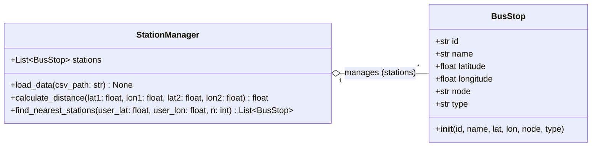
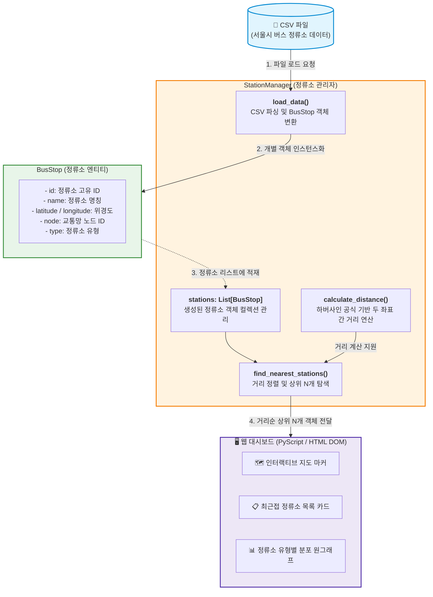

# OOP-kwangwoon
광운대학교 객체지향프로그래밍 팀 프로젝트
# 🚌 BusFinder

> **서울시 버스 정류소 위치 기반 맞춤형 탐색 대시보드**  
> 사용자의 현재 위치를 기반으로 인접한 버스 정류소를 빠르게 탐색하고, 인터랙티브 지도 및 유형별 분포 통계를 제공하는 객체지향 프로그래밍(OOP) 기반 웹 대시보드입니다.

---

## 📌 목차
1. [프로젝트 개요](#1-프로젝트-개요)
2. [실행 및 배포 방법 (GitHub Pages)](#2-실행-및-배포-방법-github-pages)
3. [사용 데이터](#3-사용-데이터)
4. [클래스 설계 및 객체 간 상호작용](#4-클래스-설계-및-객체-간-상호작용)
   - [4.1. UML 클래스 다이어그램](#41-uml-클래스-다이어그램)
   - [4.2. 시스템 아키텍처 및 데이터 흐름](#42-시스템-아키텍처-및-데이터-흐름)
   - [4.3. 클래스 상세 명세](#43-클래스-상세-명세)
   - [4.4. 거리 계산 알고리즘 (하버사인 공식)](#44-거리-계산-알고리즘-하버사인-공식)
5. [대시보드 기능 설명](#5-대시보드-기능-설명)

---

## 1. 프로젝트 개요

**BusFinder**는 서울시 버스 정류소 위치 공공데이터를 기반으로 사용자 위치에서 가장 가까운 버스 정류소 정보를 계산하여 직관적으로 시각화하는 웹 애플리케이션입니다.

- **객체지향 설계(OOP)**: 개별 정류소 도메인 데이터를 캡슐화하는 `BusStop` 클래스와 대용량 정류소 컬렉션 관리 및 비즈니스 연산 로직을 총괄하는 `StationManager` 클래스로 명확히 역할을 분리했습니다.
- **서버리스 웹 런타임 (PyScript)**: 별도의 백엔드 서버 없이 브라우저 환경에서 WebAssembly 기반 PyScript를 실행하여 파이썬 객체지향 연산 로직과 HTML DOM을 직접 바인딩합니다.
- **접근성 극대화**: 정적 웹 호스팅 서비스인 **GitHub Pages**를 통해 링크 접속만으로 즉시 구동됩니다.

---

## 2. 실행 및 배포 방법 (GitHub Pages)

본 프로젝트는 PyScript 런타임을 통해 브라우저 내부에서 파이썬 코드가 실행되므로, 로컬 서버 설치나 종속성 빌드 없이 **GitHub Pages 웹 링크 접속**만으로 실행됩니다.

### 🌐 온라인 접속 방법
1. 배포된 **GitHub Pages 배포 링크**에 웹 브라우저(Chrome, Edge, Safari 등)로 접속합니다.
   - `https://<GitHub-Username>.github.io/<Repository-Name>/`
2. 웹 브라우저의 **위치 정보 접근 권한(GPS)** 허용 알림 창이 나타나면 **'허용'**을 선택합니다.
   *(권한이 차단된 경우, 기본 위치 또는 화면 내 위치 검색 기능을 통해 기준점을 지정할 수 있습니다.)*
3. PyScript 런타임 초기화 및 정류소 데이터 로드가 완료되면 대시보드 화면이 자동으로 표시됩니다.

### ⚙️ GitHub Pages 배포 설정 (저장소 관리자용)
저장소 코드를 GitHub Pages로 서비스하기 위한 단계는 다음과 같습니다:
1. GitHub 저장소 상단 메뉴의 **Settings**로 이동합니다.
2. 좌측 네비게이션 바에서 **Pages** 탭을 선택합니다.
3. **Build and deployment** 항목의 **Source**를 `Deploy from a branch`로 설정합니다.
4. 배포 **Branch**를 `main` (또는 `master`), 디렉터리를 `/(root)`로 지정한 후 **Save** 버튼을 클릭합니다.
5. 배포 빌드가 완료되면 상단에 부여된 URL을 통해 웹 대시보드에 접근할 수 있습니다.

---

## 3. 사용 데이터

서울시 열린데이터광장에서 제공하는 **서울시 버스 정류소 위치 정보** CSV 데이터를 기반으로 구축되었습니다.

| 속성명 | 데이터 타입 | 설명 |
| :--- | :--- | :--- |
| `id` (정류소 ID) | `String` / `Int` | 각 정류소를 식별하는 고유 관리 번호 |
| `name` (정류소명) | `String` | 버스 정류소의 공식 명칭 |
| `latitude` (위도) | `Float` | 정류소의 WGS84 위도 좌표 ($\phi$) |
| `longitude` (경도) | `Float` | 정류소의 WGS84 경도 좌표 ($\lambda$) |
| `node` (노드 모바일 ID) | `String` / `Int` | 교통 네트워크 연계용 정류소 노드 식별자 |
| `type` (정류소 유형) | `String` | 중앙차로, 가로변, 마을버스 정류소 등 설치 형태 |

---

## 4. 클래스 설계 및 객체 간 상호작용

### 4.1. UML 클래스 다이어그램

객체지향 설계 원칙에 따라 데이터의 상태를 관리하는 `BusStop`과 처리 로직을 담당하는 `StationManager` 사이의 1:N 집약(Aggregation) 관계를 모델링했습니다.

---

### 4.2. 시스템 아키텍처 및 데이터 흐름

CSV 데이터 로드부터 객체 인스턴스화, 하버사인 거리 계산, 그리고 프론트엔드 UI 렌더링에 이르는 전체 데이터 파이프라인 흐름도입니다.

---

### 4.3. 클래스 상세 명세

#### 1) `BusStop` 클래스
- **역할 및 책임**: 개별 버스 정류소의 고유 정보를 캡슐화하는 데이터 모델 클래스입니다.
- **주요 속성**:
  - `id`: 정류소 고유 식별 번호
  - `name`: 정류소 공식 이름
  - `latitude`, `longitude`: 정류소의 위도 및 경도 좌표
  - `node`: 버스 노드 번호
  - `type`: 정류소 유형 (중앙차로 / 가로변 등)

#### 2) `StationManager` 클래스
- **역할 및 책임**: 버스 정류소 데이터의 전체 생명주기를 총괄하며 대량의 `BusStop` 인스턴스를 관리하고 거리 탐색 알고리즘을 수행합니다.
- **주요 속성**:
  - `stations`: 시스템에 로드된 전체 `BusStop` 객체들을 담고 있는 리스트 (`List[BusStop]`)
- **주요 메서드**:
  - `load_data(file_path)`: CSV 파일 데이터를 읽어 들여 행마다 `BusStop` 인스턴스를 생성하고 `stations` 리스트에 적재합니다.
  - `calculate_distance(lat1, lon1, lat2, lon2)`: 두 지점의 위경도를 받아 하버사인 공식을 적용하여 실제 구면 거리를 계산합니다.
  - `find_nearest_stations(user_lat, user_lon, n=10)`: 사용자 기준 좌표와 모든 정류소 간 거리를 연산한 뒤, 가까운 순서로 정렬하여 상위 $n$개의 정류소 정보 및 거리 목록을 반환합니다.

---

### 4.4. 거리 계산 알고리즘 (하버사인 공식)

지구 구면 곡률을 고려하여 두 지점 사이의 대원 거리(Great-circle distance)를 정밀하게 구하기 위해 **하버사인 공식(Haversine Formula)**을 적용했습니다.

두 지점의 위도/경도 $(\phi_1, \lambda_1)$과 $(\phi_2, \lambda_2)$ 사이의 거리 $d$는 다음과 같이 도출됩니다:

$$
\Delta \phi = \phi_2 - \phi_1, \quad \Delta \lambda = \lambda_2 - \lambda_1
$$

$$
a = \sin^2\left(\frac{\Delta \phi}{2}\right) + \cos(\phi_1)\cos(\phi_2)\sin^2\left(\frac{\Delta \lambda}{2}\right)
$$

$$
c = 2 \cdot \arctan2\left(\sqrt{a}, \sqrt{1-a}\right)
$$

$$
d = R \cdot c
$$

*(단, 지구의 평균 반지름 $R = 6371\text{ km}$를 기준 상수로 적용)*

---

## 5. 대시보드 기능 설명

대시보드는 직관적인 사용자 경험(UX)을 고려하여 지도, 목록, 통계 차트가 유기적으로 연동되도록 구성되었습니다.

| 화면 구성 | 시각화 요소 | 연동 데이터 | 기능 및 사용자 인터랙션 |
| :--- | :--- | :--- | :--- |
| **인터랙티브 지도** | Leaflet.js 기반 동적 지도 레이어 | 사용자 좌표 및 주변 10개 정류소 좌표 | 사용자 위치(중심 핀)와 주변 정류소 위치를 마커로 표시합니다. 마커 클릭 시 정류소명, 노드 번호, 이격 거리가 담긴 팝업창을 노출합니다. |
| **정류소 상세 목록** | 반응형 카드 뷰 및 리스트 | `BusStop` 인스턴스 정보 및 계산된 거리 | 가장 가까운 10개 정류소의 이름, 정류소 유형, 사용자 위치로부터의 거리($\text{m}$ 단위)를 오름차순으로 정렬하여 표시합니다. |
| **유형별 분포 통계** | Chart.js 기반 도넛/원그래프 (Pie Chart) | 추출된 10개 정류소의 `type` 필드 통계 | 탐색된 주변 정류소의 유형(중앙차로, 가로변 등) 비율을 원그래프로 시각화하여 주변 대중교통 인프라의 형태를 한눈에 파악할 수 있도록 돕습니다. |
| **실시간 위치 갱신** | 브라우저 Geolocation API | 브라우저 GPS 센서 좌표 | '내 위치 찾기' 버튼을 통해 사용자의 실시간 좌표를 다시 받아와 정류소 탐색 연산 및 대시보드 화면을 즉시 갱신합니다. |
